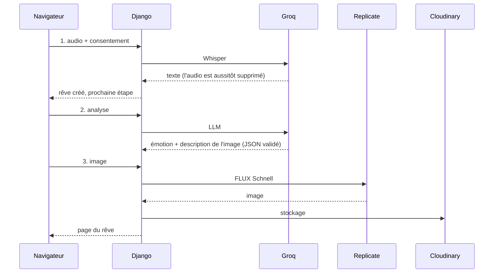

# Synthétiseur de rêves

[](https://github.com/prisciliagb/synthetiseur-de-reves/actions/workflows/ci.yml)

Racontez votre rêve à voix haute au réveil. L'application le transcrit, détecte
l'émotion qu'il dégage et le transforme en image. Vous retrouvez ensuite tous vos
rêves dans un historique, avec des statistiques sur vos émotions.

**Application en ligne :** _lien à ajouter après le déploiement sur Render_

## Sommaire

- [Fonctionnalités](#fonctionnalités)
- [Architecture](#architecture)
- [Installation](#installation)
- [Variables d'environnement](#variables-denvironnement)
- [Tests et qualité](#tests-et-qualité)
- [Déploiement](#déploiement)
- [Sécurité et RGPD](#sécurité-et-rgpd)

## Fonctionnalités

- **Compte utilisateur** : inscription avec consentement RGPD obligatoire,
  connexion. Chacun ne voit que ses propres rêves.
- **Enregistrement au micro** dans le navigateur (5 minutes maximum), avec
  réécoute avant l'envoi et consentement explicite avant chaque envoi.
- **Traitement par l'IA**, en trois étapes affichées en direct :
  1. transcription de la voix en texte ;
  2. détection de l'émotion (heureux, triste, stressant, effrayant, étrange,
     neutre) ;
  3. création d'une image qui illustre le rêve.
- **Reprise après erreur** : si une étape échoue, les résultats déjà obtenus sont
  gardés, et un bouton relance seulement les étapes manquantes.
- **Historique** paginé, du plus récent au plus ancien, avec miniatures, filtres
  par période et par émotion, et suppression d'un rêve après confirmation.
- **Statistiques** : rêves par semaine, répartition des émotions et émotion
  dominante. Les filtres de l'historique s'y appliquent aussi.
- **Suivi des coûts** : chaque appel aux API est tracé, et le coût cumulé estimé
  est consultable dans l'admin. L'endpoint `/health` donne l'état de
  l'application.

## Architecture

### Technologies

| Rôle | Choix |
|---|---|
| Application web | Python 3.12, Django 6.1 (vues fondées sur des classes) |
| Base de données | PostgreSQL 17 (SQLite possible en local) |
| Transcription | Groq, modèle Whisper `whisper-large-v3-turbo` |
| Émotion et description de l'image | Groq, LLM `openai/gpt-oss-20b` (réponse en JSON) |
| Image | Replicate, modèle FLUX Schnell |
| Stockage des images | Cloudinary |
| Interface | Templates Django, Bootstrap 5, JavaScript sans framework, Chart.js |
| Production | Gunicorn, WhiteNoise, Render |

### Parcours d'un rêve



Chaque étape est une **requête séparée**, que le JavaScript (`static/js/pipeline.js`)
lance l'une après l'autre. On peut donc afficher l'avancement, et une étape qui
échoue n'annule pas les précédentes.

### Organisation du code

```
config/              réglages, URL principales, page d'accueil et /health
accounts/            utilisateur personnalisé, inscription avec consentement RGPD
dreams/
├── models.py        Dream (le rêve) et ApiCall (suivi des appels aux API)
├── views.py         historique, détail, enregistrement, étapes, suppression
├── forms.py         contrôle de l'audio, filtres de l'historique
├── services/        toute la logique métier, séparée des vues
│   ├── api.py           appel commun : délai, nouvelles tentatives, suivi des coûts
│   ├── transcription.py Groq Whisper
│   ├── analysis.py      émotion et description de l'image (Groq LLM)
│   ├── image.py         génération (Replicate) et téléchargement de l'image
│   └── pipeline.py      enchaînement des étapes et reprise après erreur
├── storage.py       stockage Django vers Cloudinary
└── signals.py       suppression de l'image quand le rêve est supprimé
dashboard/           tableau de bord : statistiques (services.py : calculs)
templates/, static/  pages, thème (static/css/theme.css) et JavaScript
loadtests/           script du test de charge (Locust)
docs/                rapport du test de charge
```

### Choix techniques

- **Les services sont séparés des vues.** Chaque API est isolée dans
  `dreams/services/`, ce qui permet de la tester seule en simulant ses réponses.
- **Un seul module gère les échecs d'API** (`services/api.py`). Il fixe un délai
  maximal, réessaie avec une attente croissante (1 s, 2 s, 4 s…) sur les erreurs
  temporaires (429, 5xx, réseau), et abandonne tout de suite sur les erreurs
  définitives (clé invalide, crédit épuisé).
- **La réponse du LLM n'est jamais crue sur parole.** Le JSON est validé : une
  émotion inconnue devient « neutre », la confiance est ramenée entre 0 et 1, et
  la description de l'image est limitée en longueur.
- **Les images sont stockées sur Cloudinary**, car le disque de Render est effacé
  à chaque déploiement. En local, sans Cloudinary, elles vont dans `media/`.
- **Les calculs de l'historique et des statistiques sont faits par la base de
  données** (pagination, `Count`, `TruncWeek`), sans charger tous les rêves en
  mémoire.

## Installation

Prérequis :
- **Git** ;
- **Python 3.12** (installation locale) ou **Docker Desktop** (installation
  avec Docker).

```bash
git clone https://github.com/prisciliagb/synthetiseur-de-reves.git
cd synthetiseur-de-reves
```

### Avec le script (recommandé)

```bash
./install.sh          # installation locale, avec un environnement virtuel
./install.sh docker   # ou avec Docker (PostgreSQL inclus)
```

Le script :
1. vérifie les prérequis ;
2. installe les dépendances ;
3. crée le fichier `.env` avec une `SECRET_KEY` aléatoire ;
4. applique les migrations ;
5. lance les tests pour vérifier que tout fonctionne.

On peut le relancer sans risque.

### À la main, avec un environnement virtuel

```bash
python3.12 -m venv .venv
source .venv/bin/activate
pip install -r requirements-dev.txt
cp .env.example .env              # puis remplir SECRET_KEY et les clés d'API
python manage.py migrate
python manage.py createsuperuser  # compte pour l'admin (facultatif)
python manage.py runserver
```

### À la main, avec Docker

```bash
cp .env.example .env              # puis remplir SECRET_KEY et les clés d'API
docker compose up -d --build
docker compose exec web python manage.py migrate
docker compose exec web python manage.py createsuperuser
```

Dans les deux cas, l'application est sur http://localhost:8000, et l'admin sur
http://localhost:8000/admin/.

> **Sans clés d'API**, le site fonctionne (comptes, historique, statistiques),
> mais l'enregistrement d'un rêve affiche « service indisponible ». Il faut les
> clés de la section suivante pour le parcours complet.

## Variables d'environnement

Elles sont lues dans le fichier `.env`, dont le modèle est `.env.example`. Ce
fichier n'est jamais versionné : les clés ne doivent pas apparaître sur GitHub.

| Variable | Obligatoire | Rôle |
|---|---|---|
| `SECRET_KEY` | oui | Clé secrète de Django (signature des sessions). |
| `DEBUG` | non (`False`) | `True` en développement uniquement. |
| `ALLOWED_HOSTS` | non | Noms de domaine autorisés, séparés par des virgules. |
| `DATABASE_URL` | non | Adresse PostgreSQL. Sans elle, SQLite est utilisé. |
| `GROQ_API_KEY` | pour l'IA | Transcription et analyse. À créer sur [console.groq.com](https://console.groq.com/keys). |
| `REPLICATE_API_TOKEN` | pour l'image | Génération de l'image. À créer sur [replicate.com](https://replicate.com/account/api-tokens). |
| `CLOUDINARY_URL` | en production | Stockage des images, de la forme `cloudinary://<clé>:<secret>@<cloud>`. À trouver sur [cloudinary.com](https://console.cloudinary.com/). |

D'autres réglages ont une valeur par défaut, qu'on peut changer dans `.env` :
- les modèles : `GROQ_WHISPER_MODEL`, `GROQ_LLM_MODEL`, `REPLICATE_MODEL` ;
- les délais et le nombre de tentatives : `GROQ_TIMEOUT`, `GROQ_MAX_ATTEMPTS`,
  `REPLICATE_TIMEOUT`, `REPLICATE_MAX_ATTEMPTS` ;
- les tarifs qui servent à estimer les coûts : `GROQ_WHISPER_PRICE_PER_HOUR`,
  `GROQ_LLM_PRICE_INPUT_PER_MILLION`, `GROQ_LLM_PRICE_OUTPUT_PER_MILLION`,
  `REPLICATE_PRICE_PER_IMAGE`.

Ils sont tous décrits dans `config/settings.py`.

## Tests et qualité

```bash
pytest                                    # 164 tests
coverage run -m pytest && coverage report # couverture : 98 %
ruff check . && ruff format --check .     # règles et mise en forme du code
```

- **Aucune API n'est appelée pendant les tests.** Groq, Replicate et Cloudinary
  sont simulés, et les clés du `.env` sont vidées automatiquement : les tests
  sont gratuits et fonctionnent hors ligne.
- **Les cas d'erreur sont testés** pour chaque API : délai dépassé, quota dépassé
  (429), crédit épuisé (402), réponse invalide.
- **Un hook pre-commit** bloque tout commit non conforme à ruff
  (`pre-commit install`).
- **L'intégration continue** (GitHub Actions) vérifie chaque PR :
  - ruff ;
  - les tests sur PostgreSQL 17 ;
  - les migrations ;
  - un seuil minimal de couverture de 70 %.

  Le rapport de couverture HTML est téléchargeable dans les « Artifacts » de
  chaque exécution. Les branches `main` et `develop` sont protégées : une PR ne
  peut être fusionnée que si la CI est verte.
- **Test de charge** (Locust) : jusqu'à 300 utilisateurs simultanés sans erreur.
  Le protocole et les résultats sont dans
  [docs/test-de-charge.md](docs/test-de-charge.md).

## Déploiement

Le déploiement sur Render est décrit dans [`render.yaml`](render.yaml) : le site
et sa base PostgreSQL, à Francfort.
- Chaque fusion sur `main` **déclenche un déploiement, seulement si la CI est
  verte**.
- Les migrations sont appliquées au démarrage.
- La `SECRET_KEY` est générée par Render.
- Les clés d'API sont saisies dans Render, jamais dans le code.

En production (`DEBUG=False`), la sécurité est renforcée :
- https obligatoire ;
- cookies sécurisés ;
- HSTS.

`python manage.py check --deploy` ne signale aucun problème. Deux avertissements
sans objet sont ignorés : l'application n'envoie pas d'e-mail, et une adresse en
`.onrender.com` ne peut pas entrer dans la liste « HSTS preload ». La raison est
écrite dans `config/settings.py`.

## Sécurité et RGPD

- **La voix n'est jamais conservée.** L'audio est envoyé à Groq pour la
  transcription, puis supprimé immédiatement, que la transcription réussisse ou
  non. Seul le texte du rêve est enregistré.
- **Le consentement est demandé deux fois** :
  - à l'inscription (la date est enregistrée) ;
  - avant chaque envoi d'un enregistrement, vérifié aussi par le serveur.
- **Le droit à l'effacement est respecté.** Supprimer un rêve ou son compte
  supprime aussi les images stockées sur Cloudinary.
- **Les données sont cloisonnées.** Un utilisateur ne peut ni voir, ni modifier,
  ni supprimer les rêves d'un autre (erreur 404).
- **Les logs ne contiennent pas de données personnelles** : ni le texte des
  rêves, ni l'auteur des appels aux API.
- **L'audio envoyé est contrôlé par son contenu** (format, taille), et non par
  le nom ou le type annoncés par le navigateur.

## Licence

Projet distribué sous licence MIT : voir [LICENSE](LICENSE).
